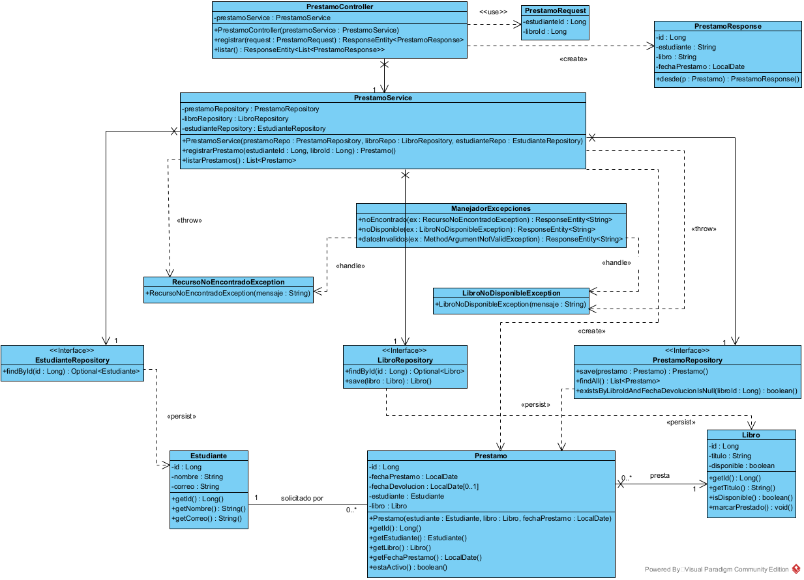
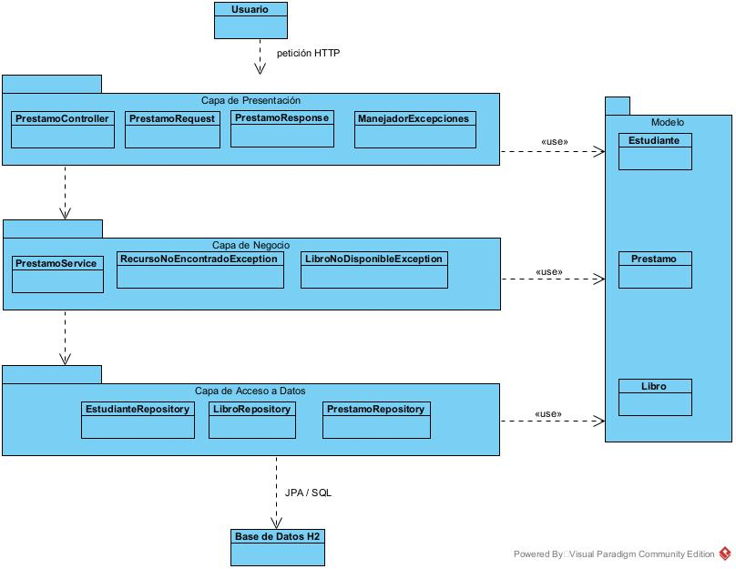
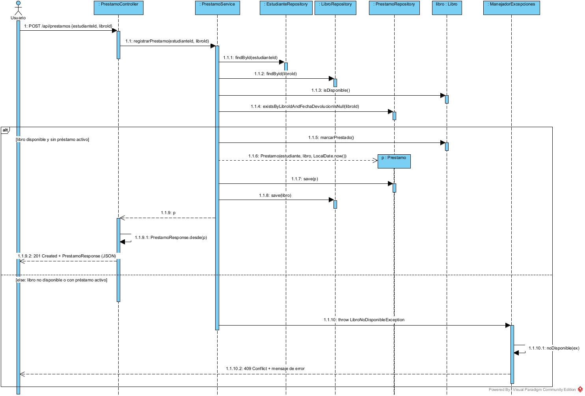

# SmartLibrary · Registrar préstamo (Taller práctico Bloque 7)

API REST con Spring Boot (Java 21, Maven, Spring Web, Spring Data JPA, Validation y H2), diseñada por tres capas a partir del modelo de clases del taller.

## Diagramas

Los diagramas están hechos en Visual Paradigm. En `diagramas/visual-paradigm/` están los archivos `.vpp` editables y en `diagramas/imagenes/` las imágenes exportadas.

| Diagrama | Imagen | Archivo Visual Paradigm |
|---|---|---|
| 1. Clases (vista normal) | [diagrama-1-clases.png](diagramas/imagenes/diagrama-1-clases.png) | [Diagrama-1-Clases.vpp](diagramas/visual-paradigm/Diagrama-1-Clases.vpp) |
| 2. Clases por capas | [diagrama-2-capas.png](diagramas/imagenes/diagrama-2-capas.png) | [Diagrama-2-Capas.vpp](diagramas/visual-paradigm/Diagrama-2-Capas.vpp) |
| 3. Secuencia `POST /api/prestamos` | [diagrama-3-secuencia.png](diagramas/imagenes/diagrama-3-secuencia.png) | [Diagrama-3-Secuencia.vpp](diagramas/visual-paradigm/Diagrama-3-Secuencia.vpp) |

### Diagrama 1 · Clases


### Diagrama 2 · Capas
Usuario → Capa de Presentación → Capa de Negocio → Capa de Acceso a Datos → Base de Datos H2. Las tres capas usan el Modelo del dominio.



### Diagrama 3 · Secuencia
Camino 1: libro disponible → `201 Created`. Camino 2: libro no disponible → `409 Conflict`.



## Correspondencia entre diagramas y código

| Capa (diagrama 2) | Paquete | Clases |
|---|---|---|
| Presentación | `controller`, `dto` | `PrestamoController`, `ManejadorExcepciones`, `PrestamoRequest`, `PrestamoResponse` |
| Negocio | `service` | `PrestamoService`, `RecursoNoEncontradoException`, `LibroNoDisponibleException` |
| Acceso a datos | `repository` | `EstudianteRepository`, `LibroRepository`, `PrestamoRepository` |
| Modelo | `model` | `Estudiante`, `Libro`, `Prestamo` |
| Base de datos | `resources` | H2 en memoria (`application.properties`, `data.sql`) |

Los atributos y métodos de cada clase son los del diagrama 1. `PrestamoService.registrarPrestamo` ejecuta los mensajes del diagrama 3 en el mismo orden: `findById(estudianteId)`, `findById(libroId)`, `isDisponible()`, `existsByLibroIdAndFechaDevolucionIsNull(libroId)`, `marcarPrestado()`, `new Prestamo(estudiante, libro, LocalDate.now())`, `save(p)` y `save(libro)`. Después, `PrestamoController` llama a `PrestamoResponse.desde(p)` y responde `201`.

Notas de implementación:
- Los repositorios heredan `findById`, `save` y `findAll` de `JpaRepository`. Por eso solo se declara `existsByLibroIdAndFechaDevolucionIsNull`.
- `SmartLibraryApplication` es la clase de arranque que exige Spring Boot. Los constructores `protected` vacíos de las entidades los exige JPA.

## Ejecutar

```
mvn spring-boot:run
```

`data.sql` carga los datos de prueba: estudiantes 1 y 2; libros 1 y 2 disponibles; libro 3 prestado.

## Escenarios de prueba

| Escenario | Petición | Esperado | Requisito |
|---|---|---|---|
| Préstamo de libro disponible | `POST /api/prestamos` `{"estudianteId":1,"libroId":1}` | 201 Created | R1, R2, R3 |
| Libro ya prestado | `POST /api/prestamos` `{"estudianteId":1,"libroId":3}` | 409 Conflict | R1, R4, R5 |
| Estudiante inexistente | `POST /api/prestamos` `{"estudianteId":99,"libroId":2}` | 404 Not Found | R4 |
| Libro inexistente | `POST /api/prestamos` `{"estudianteId":1,"libroId":99}` | 404 Not Found | R4 |
| Consulta de préstamos | `GET /api/prestamos` | 200 OK | — |

Consola H2: `http://localhost:8080/h2-console` (JDBC URL `jdbc:h2:mem:smartlibrary`, usuario `sa`).
